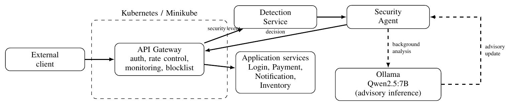
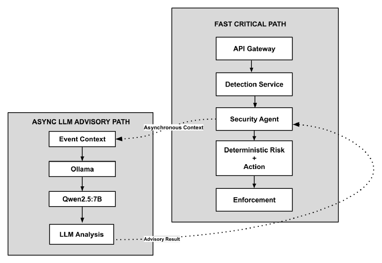
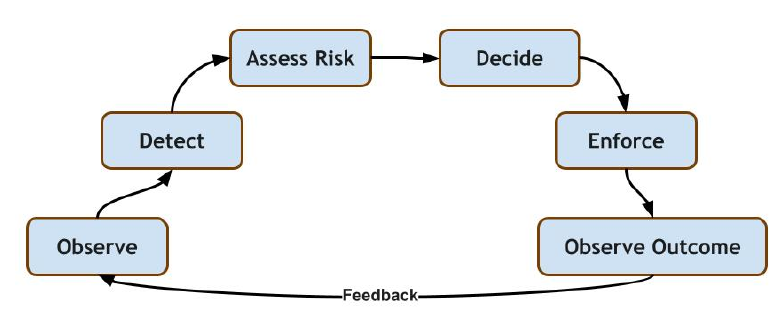
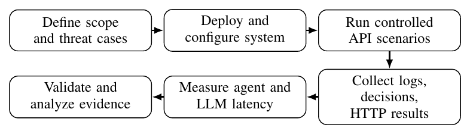
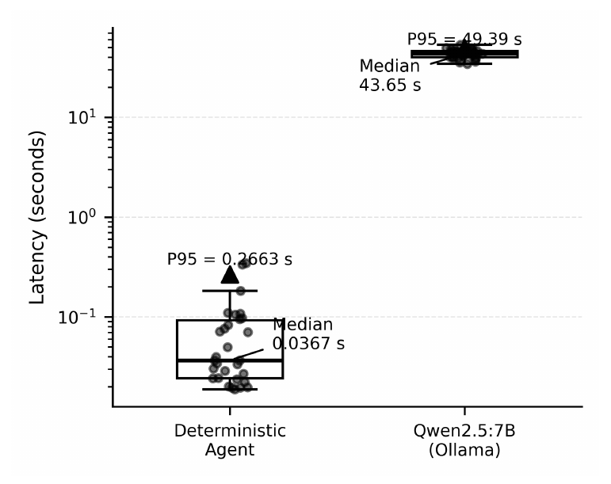

# Cloud-Native Agentic Cyber Defense Platform for Zero-Day Attack Mitigation

> **Research Notice**
>
> This repository accompanies a research paper that has been accepted for presentation at a conference and is awaiting publication. The code, documentation, figures, and written content here are part of that ongoing research work awaiting publication. Until the paper is formally published, copying, reproducing, redistributing, or reusing any part of this material, including the text, figures, and experimental results, is not recommended and is not permitted without prior written permission. If you wish to refer to this work, please contact and cite the published paper once it becomes available.

A Kubernetes-based prototype that combines an API gateway, behavioural monitoring, a detection service, deterministic risk-based decisions, and asynchronous large language model (LLM) reasoning to detect and contain suspicious API behaviour in cloud-native applications.

The central design decision of this project is that **immediate enforcement never depends on LLM inference**. The security agent selects a deterministic action within milliseconds, while a local LLM (Qwen2.5:7B served through Ollama) performs contextual analysis in the background as an advisory layer.

This repository accompanies the research paper *"Cloud-Native Agentic Cyber Defense Platform for Zero-Day Attack Mitigation"*.

---

## Table of Contents

1. [Overview](#overview)
2. [Key Results](#key-results)
3. [Scope and Honest Claims](#scope-and-honest-claims)
4. [System Architecture](#system-architecture)
5. [Threat Model](#threat-model)
6. [Detection and Response Method](#detection-and-response-method)
7. [Asynchronous LLM-Assisted Reasoning](#asynchronous-llm-assisted-reasoning)
8. [Technology Stack](#technology-stack)
9. [Getting Started](#getting-started)
10. [Experimental Methodology](#experimental-methodology)
11. [Evaluation Environment](#evaluation-environment)
12. [Results](#results)
13. [Discussion and Standards Alignment](#discussion-and-standards-alignment)
14. [Limitations](#limitations)
15. [Future Work](#future-work)


---

## Overview

Cloud-native applications distribute functionality across independently deployed services managed by orchestrators such as Kubernetes. This creates a distributed security boundary: requests pass through a chain of services, and suspicious activity must be detected and contained without disrupting legitimate traffic.

Zero-day attacks make this harder because no signature exists for an unknown exploit. Anomaly-based and machine-learning approaches look for deviations from expected behaviour instead. Recent research has also explored LLMs for threat interpretation, planning, and response. However, LLM inference is slow and its output is probabilistic, which raises an engineering question: should immediate enforcement depend on a model completing its output?

This project answers that question by separating the system into two paths:

- **A fast, deterministic enforcement path.** The API gateway detects an anomalous behaviour, the detection service forwards the event, the security agent assigns a risk score and action, and the gateway enforces it.
- **A slow, asynchronous advisory path.** After the deterministic decision is returned, the agent runs background analysis through a local LLM. The result enriches the event record but does not govern the block.

### Contributions

1. A Kubernetes-based architecture in which the API gateway, detection service, and security-agent service run together in a single stack.
2. A lightweight request-frequency detector paired with client-level enforcement.
3. An asynchronous Qwen2.5:7B advisory path that does not control immediate blocking.
4. Functional and latency measurements that characterise the implemented prototype.

---

## Key Results

| Measurement | Value |
|---|---|
| Behaviours validated end to end | Authentication failures, rate-limit abuse, high-frequency requests |
| Main test | Six authenticated requests within 10 seconds triggered a high-frequency anomaly |
| Agent decision for main test | Risk 85, confidence 0.90, action `BLOCK_CLIENT` |
| Enforcement outcome | The next request using the valid API key returned HTTP 403 |
| Median deterministic agent API response (30 trials) | 36.7 ms |
| Median direct local LLM completion (30 trials) | 43.652 s |
| Direct LLM completion range | 34.2743 s to 53.1790 s |

---

## Scope and Honest Claims

The term "zero-day mitigation" in the project title describes the motivating goal of behavioural resilience. It is **not** a demonstrated ability to discover arbitrary unknown vulnerabilities.

- The experiments cover three characterised behaviours only.
- The evaluation is a set of functional tests, not a zero-day benchmark.
- No precision, recall, false-positive rate, or generalised detection performance is reported.
- The deterministic rule is a reproducible behavioural control point, not a general-purpose learned zero-day detector.
- The latency comparison measures two different operations (an agent API response and a raw model completion). It is not a like-for-like comparison of the same task.
- The LLM log evidence demonstrates asynchronous execution only. It does not show that the LLM caused or contributed to any mitigation.

---

## System Architecture

The prototype consists of an API gateway and several FastAPI services deployed independently on Kubernetes (Minikube). The login, payment, notification, and inventory services, together with the Detection Service and the Security Agent service, run as workloads. Only the gateway is exposed to the outside world. Kubernetes Services provide stable service discovery and internal communication.



*Overall architecture. Solid arrows represent request, event, or enforcement communication. Dashed arrows represent asynchronous LLM analysis and advisory updates.*

### Components

| Component | Responsibility |
|---|---|
| API Gateway | Entry point. Handles authentication, rate control, request monitoring, and the client blocklist. Performs enforcement. |
| Application services | Login, Payment, Notification, and Inventory services protected by the gateway. |
| Detection Service | Receives structured security events from the gateway and forwards them to the Security Agent. |
| Security Agent | Classifies events into deterministic risk scores and recommended actions. Triggers background LLM analysis. |
| Ollama with Qwen2.5:7B | Local LLM runtime used only for asynchronous advisory analysis. |

### Critical Path versus Advisory Path

The enforcement path (API Gateway, Detection Service, Security Agent, deterministic risk and action, enforcement) never waits for the LLM. The advisory path (event context, Ollama, Qwen2.5:7B, LLM analysis) runs in parallel and feeds back an advisory result only.



*LLM completion is not a prerequisite for enforcement.*

### Control Loop

The system follows an observe, detect, assess, decide, enforce cycle, with feedback from the enforcement outcome returning to observation.



---

## Threat Model

The protected environment includes an externally exposed API gateway, authentication and rate control, and the internal application services.

**Attacker capability.** The attacker can send requests to the gateway and attempt intrusive authentication, excessive requests, or unusually frequent access.

**Evaluated behaviours.**

1. Repeated authentication failures
2. Rate-limit abuse
3. High-frequency requests

**Out of scope.** Exploit payloads, kernel-level compromise, and arbitrary unknown vulnerabilities are not evaluated.

---

## Detection and Response Method

The gateway monitors client messages and maintains a limited per-client behavioural history. For the high-frequency rule, the detector checks whether a client has sent more than five requests within a 10-second window:

```
A(c) = 1   if N_c(10s) > 5
       0   otherwise
```

When the rule fires, the gateway produces a structured anomaly event containing:

- `eventType`
- `clientAddress`
- `requestCount`
- `observationWindow`
- `pathContext`

The event is sent to the Detection Service, which forwards it to the Security Agent. The agent maps each event type to a deterministic risk score, confidence, and recommended action. The gateway then performs the supported containment action, either a client block or a temporary block.

### Event Classification

| Scenario | Event type | Risk | Confidence | Agent action |
|---|---|---|---|---|
| Authentication failures | `BRUTE_FORCE_SUSPECTED` | 80 | 0.90 | `BLOCK_CLIENT` |
| Rate-limit abuse | `RATE_LIMIT_ABUSE` | 70 | 0.85 | `TEMPORARY_BLOCK` |
| High request frequency | `HIGH_REQUEST_FREQUENCY` | 85 | 0.90 | `BLOCK_CLIENT` |

---

## Asynchronous LLM-Assisted Reasoning

The Agent Service does not wait for the local model. It returns the deterministic decision immediately, with the event's advisory status set to `llm_status=pending`. It then runs background analysis through Ollama using Qwen2.5:7B. When the analysis completes, the event's advisory status is updated.

The LLM output is a contextual evaluation attached to an existing event. It is not the decision for the block that has already happened. In the main test, the model's assessment noted that the client on the loopback interface was making a large number of requests and considered this suspicious. The start, completion, and background update of this analysis were recorded in logs.

---

## Technology Stack

| Layer | Technology |
|---|---|
| Services | Python, FastAPI microservices |
| Containerisation | Docker Desktop |
| Orchestration | Kubernetes via Minikube |
| LLM runtime | Ollama 0.33.3 |
| Model | Qwen2.5:7B, Q4_K_M quantisation |
| LLM endpoint (from containers) | `host.docker.internal:11434` |

---

## Getting Started

The steps below describe the environment used in the paper. Adjust manifest and directory names to match the layout of this repository.

### Prerequisites

- Docker Desktop
- Minikube and `kubectl`
- Ollama with the `qwen2.5:7b` model available locally
- Python 3 with FastAPI (for running individual services outside the cluster)

### Setup Outline

1. Start Minikube.

   ```bash
   minikube start
   ```

2. Pull the model and make sure Ollama is listening on port 11434 on the host.

   ```bash
   ollama pull qwen2.5:7b
   ```

3. Build the service images so that Minikube can use them (the gateway, login, payment, notification, inventory, detection, and agent services).

4. Apply the Kubernetes manifests for all services.

   ```bash
   kubectl apply -f <path-to-manifests>
   ```

5. Expose the gateway through a NodePort or port-forward.

   ```bash
   kubectl port-forward svc/<gateway-service-name> 8000:8000
   ```

6. Confirm that the Security Agent can reach the Ollama service through the host endpoint (`host.docker.internal:11434`).

### Reproducing the Main Test

Send six rapid, authenticated requests to the gateway's `/services` endpoint within ten seconds, then send a seventh request with the same valid API key.

- Requests one to six return HTTP 200, because the detector checks the current request before the decision is made.
- At count six, the gateway logs `HIGH_REQUEST_FREQUENCY`, the Detection Service forwards the event, and the agent returns risk 85 with `BLOCK_CLIENT`.
- The seventh request returns HTTP 403 with a client-blocked response.

---

## Experimental Methodology

The three scenarios were exercised with controlled API requests. Event forwarding, agent decisions, and HTTP outcomes following each event were checked. Latency was measured separately for the deterministic Agent API and for the direct Ollama/Qwen2.5:7B completion, with 30 measurements each.



*Workflow: define scope and threat cases, deploy and configure the system, run controlled API scenarios, collect logs, decisions, and HTTP results, measure agent and LLM latency, and validate and analyse the evidence.*

The latency boundaries are deliberately distinct: one is the response of the Agent Service `/analyze` API, the other is a direct model completion. The functional tests verify behaviour for the tested cases and are not estimates of population-level detection rates.

---

## Evaluation Environment

| Parameter | Configuration |
|---|---|
| CPU | Intel Core i5-1235U, 12th Gen |
| Memory / GPU | 16 GB / Intel Iris Xe integrated graphics |
| Operating system | Windows |
| Runtime / orchestration | Docker Desktop / Minikube (Kubernetes) |
| Application stack | Python, FastAPI microservices |
| LLM runtime | Ollama 0.33.3 |
| Model | Qwen2.5:7B, Q4_K_M |
| LLM endpoint | `host.docker.internal:11434` |

---

## Results

### Functional Validation

| Scenario | Detection result | Risk | Agent action | Observed enforcement evidence |
|---|---|---|---|---|
| Authentication failures | `BRUTE_FORCE_SUSPECTED` | 80 | `BLOCK_CLIENT` | Initial 401 response; subsequent requests rejected with 403 |
| Rate-limit abuse | `RATE_LIMIT_ABUSE` | 70 | `TEMPORARY_BLOCK` | First ten requests succeeded; request eleven returned 429, followed by containment |
| High request frequency | `HIGH_REQUEST_FREQUENCY` | 85 | `BLOCK_CLIENT` | Six requests observed in 10 s; subsequent request returned 403 |

**Authentication failures.** Five requests with an invalid key produced an initial HTTP 401 response. After the client was contained, subsequent requests returned HTTP 403. The agent classified the event as `BRUTE_FORCE_SUSPECTED` with risk 80 and confidence 0.90, and recommended `BLOCK_CLIENT`.

**Rate-limit abuse.** The first ten rapid requests succeeded and the eleventh returned HTTP 429. The resulting `RATE_LIMIT_ABUSE` event received risk 70, confidence 0.85, and a `TEMPORARY_BLOCK` action.

**High-frequency requests (main end-to-end case).** Six rapid authenticated calls were made to the `/services` endpoint. All six returned HTTP 200, since the detector evaluates the current request before the decision is made. At count six the gateway logged `HIGH_REQUEST_FREQUENCY` (the threshold being more than five requests in ten seconds). The Detection Service forwarded the event, and the Agent Service returned risk 85, confidence 0.90, and `BLOCK_CLIENT`. A subsequent request using the valid API key returned HTTP 403 with a client-blocked response. This is consistent with the complete event-to-enforcement process, and it also confirms that the triggering request itself was not rejected retroactively.

### Latency Evaluation

Two different operations were timed, with 30 trials each:

| Benchmark | What is measured | Median | Range / note |
|---|---|---|---|
| Deterministic agent | Agent Service `/analyze` API response | 0.0367 s | P95 = 0.2663 s |
| Direct LLM | Ollama/Qwen2.5:7B completion | 43.6520 s | 34.2743 s to 53.1790 s; P95 = 49.39 s |



*Measured latency comparison on a logarithmic scale. The Agent API and direct LLM benchmarks measure different operations.*

### Summary

- The implemented pipeline converts the three tested behaviours into deterministic actions and observable HTTP results.
- The high-frequency case provides end-to-end evidence of the full loop.
- The latency data indicates that local LLM inference should not be placed in the enforcement path.
- The experiments do not establish precision, recall, false-positive rate, or generalised zero-day detection performance.

---

## Discussion and Standards Alignment

The results indicate a clean architectural separation between enforcement and contextual analysis. In the tested environment the Agent API responded in tens of milliseconds at the median, while local model completion took tens of seconds. Making enforcement depend on the model would couple response time to inference. The asynchronous design removes that dependency for the demonstrated deterministic actions. This is an engineering observation for the measured configuration, not a universal statement about all LLM deployments.

The workflow draws on the following reference points. These are design alignments, not claims of certification or formal compliance.

| Framework | Relevance |
|---|---|
| NIST CSF 2.0 | Cybersecurity outcomes |
| NIST SP 800-61 Rev. 3 | Incident response |
| NIST AI RMF | Separating bounded enforcement from model-generated advice |
| OWASP API Security Top 10 (2023) | API-key authentication and rate controls |
| MITRE ATT&CK | Vocabulary for future mapping of observed behaviours |

---

## Limitations

- Evaluation was performed on a single development machine with Minikube and does not reflect production-cluster performance.
- The behavioural detector relies on a limited set of application-level signals and a predefined request-frequency threshold.
- Tests cover three characterised behaviours, not random exploits or a labelled zero-day benchmark.
- No statistical detection metrics are reported.
- The gateway blocklist is stored in memory only and is lost when the gateway restarts.
- Multi-replica coordination and durable enforcement state are not demonstrated.
- LLM latency figures are specific to the tested model, quantisation, and hardware.

---

## Future Work

- Test larger and more varied traffic sets, unseen behavioural variants, and benign workloads.
- Repeat scenarios across configurations and report the distribution of detection and mitigation latency.
- Measure false-positive rates and resource overhead.
- Evaluate behaviour when LLM inference is delayed or unavailable.
- Add persistent, shared enforcement state across gateway replicas.
- Expand telemetry and map observed behaviours to MITRE ATT&CK.

---


